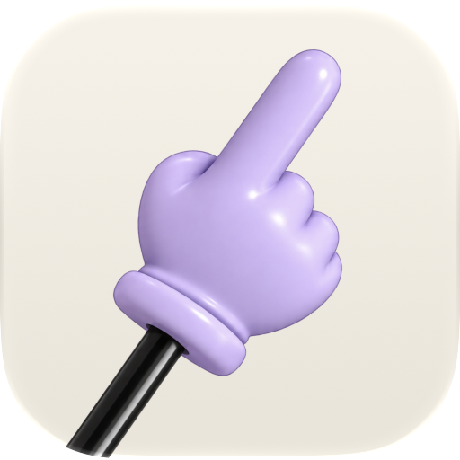

# TinyHand integration

A native macOS menu bar pointer with normal clicking, screen annotations and screenshot capture. This branch contains Austin's [selected fork ideas](docs/INTEGRATION.md).

## Build the review app

All builds and tests run locally on the Mac. Hosted CI remains disabled.

```sh
bash scripts/run-tests.sh
bash scripts/build-review.sh --open
```

The review app is `dist/TinyHand Integration.app`, with a separate bundle ID,
preferences and custom-hand folder. Its review bundle has no automatic-update feed.
The helper also copies the bundle to `~/Applications`; the verified review runner
starts the project copy. Signing uses an available Developer ID identity, or the
CODESIGN_IDENTITY override. This is a review build, not a notarized release.

## Use

Click the menu bar icon to turn the pointer on or off. Right-click it for commands.

| Action | Default shortcut |
| --- | --- |
| Turn pointer on/off | Control-Option-H |
| Point / Draw | Control-Option-D while the pointer is on |
| Clear drawing | Control-Option-X |
| Take screenshot | Control-Option-S while the pointer is on |
| Show/hide toolbar | Control-Option-T while the pointer is on |
| Pen / Rectangle / Arrow / Text / Number | F / R / A / T / N in Draw |
| Undo / Redo annotation | Command-Z / Command-Shift-Z in Draw |
| Next / previous pinned pointer | Control-Option-Right / Left |
| Toggle tap sound | Control-Option-M |
| Match ink to pointer | Control-Option-A |
| Settings | Command-comma while in Draw, or the menu |
| Exit pointer | Escape, except while editing text or using a menu |

Point leaves native clicks, modifier clicks, dragging and typing available. Draw
captures annotation gestures. Hold the configured interaction key, Option by
default, to temporarily use apps while in Draw.

Number markers can be placed with the Number tool or Control-click. Drag one to
move it; click it to remove it. Text opens a focused editor; Return adds the label
and Escape cancels. Clear Drawing and marker edits participate in Undo.

Drag the toolbar handle to move it. Right-click the handle, or use Appearance →
Reset Position, to recenter it. Settings → Drawing controls line width, opacity,
smoothing, color and fading independently of hand size.

Settings → Appearance → Motion offers Original and Responsive. Original keeps
the existing grip swing. Responsive follows more closely and uses a display link
on macOS 14 or later. macOS 13 uses the same responsive grip with the timer fallback.

Screenshots include annotations and the pointer while omitting app controls.
The camera button temporarily hides the hand so it does not point at the camera
control in the image. Choose clipboard, folder output, or both in General.

Drawing requires Accessibility. Screenshots require Screen Recording. General
shows permission state and links to the relevant system settings. Point remains
available without drawing permission.

When comparing two pointer apps, run one at a time or give them different global
shortcuts.

## Local automation and verification

The executable exposes a versioned JSON interface over a same-user private socket.
Run its `--help`, then read [the control protocol](docs/control-protocol.md).

[Validation results](docs/VALIDATION.md) record local unit, native-input, UI and
packaging checks. [Architecture](ARCHITECTURE.md) describes the modules. The
[complete fork audit](docs/research/tinyhand-fork-evidence.md) preserves donor
commits and source references.

## Credits and license

Based on [TinyHand by Kamran Ahmed](https://github.com/nilbuild/tinyhand).
Selected ideas and implementation references come from the forks credited in the
audit. The original MIT notice is preserved in [LICENSE](LICENSE).
