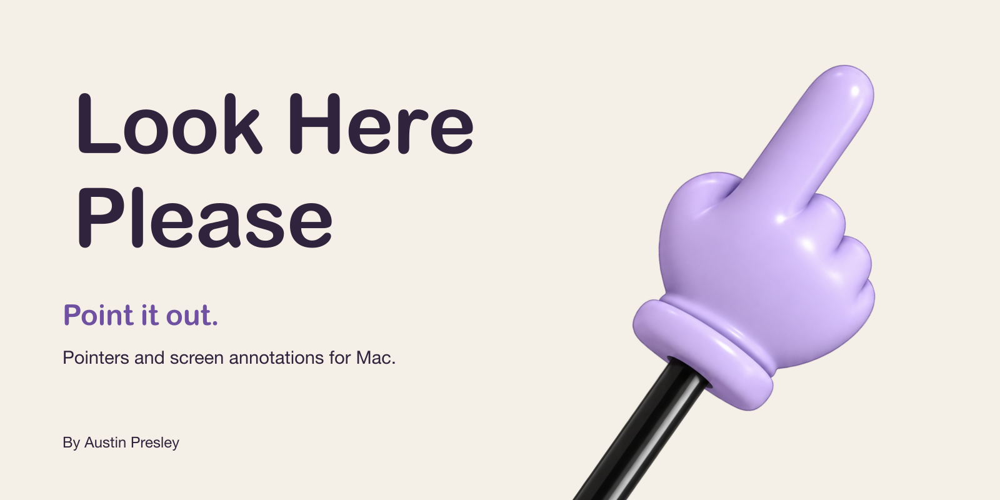
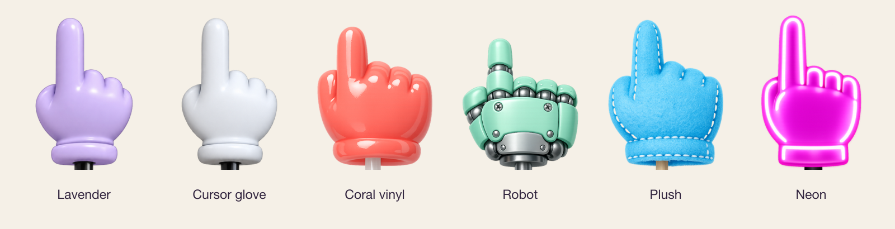

# Look Here Please

**Point it out.** Pointers and screen annotations for Mac, by Austin Presley.

Put a hand where you want people to look. Draw an arrow, highlight a detail,
or add a note as you explain.

> The expanded app is in local review on Austin's Mac. There is no public
> Look Here Please build yet. The default `main` branch still contains the
> earlier functional source.

## A hand for the occasion

Go with the lavender toy, a classic glove, a robot or something softer.
Use a laser when a hand would be too much.

## In the local review app

- **Point with personality.** Choose from the hand collection or use a laser.
- **Mark up your screen.** Draw, highlight, place arrows and shapes, or add text
  and number markers. Undo and clear as you go.
- **Keep controls close.** Use the menu bar, quick controls at your cursor,
  or Stream Deck. The floating toolbar is optional.
- **Use the app underneath.** Turn Interact on for normal clicks and drags,
  then turn it off to annotate again.

macOS 13 or later. See [project status](docs/project-status.md) for the current
scope and remaining review work. Tests, builds and packaging run locally on
Austin's Mac. Hosted CI stays disabled.

## Credits and license

Look Here Please is an MIT-licensed fork of
[TinyHand by Kamran Ahmed](https://github.com/nilbuild/tinyhand).
The product direction and branding are by Austin Presley. The original
[MIT license](LICENSE) is preserved.
