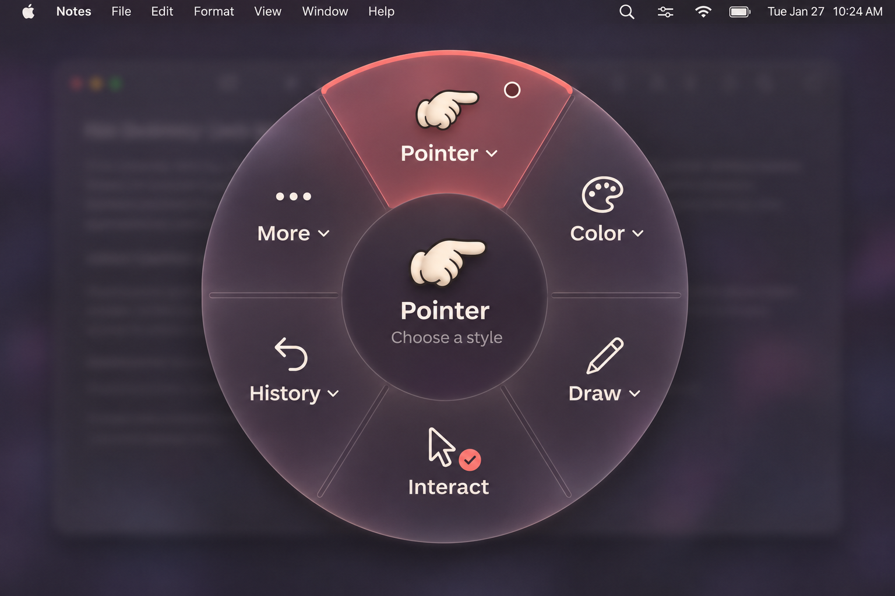
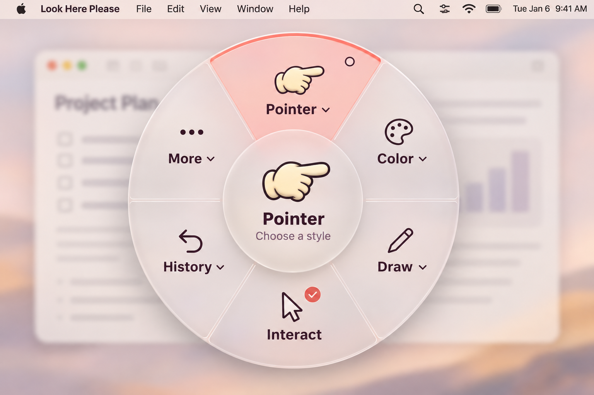
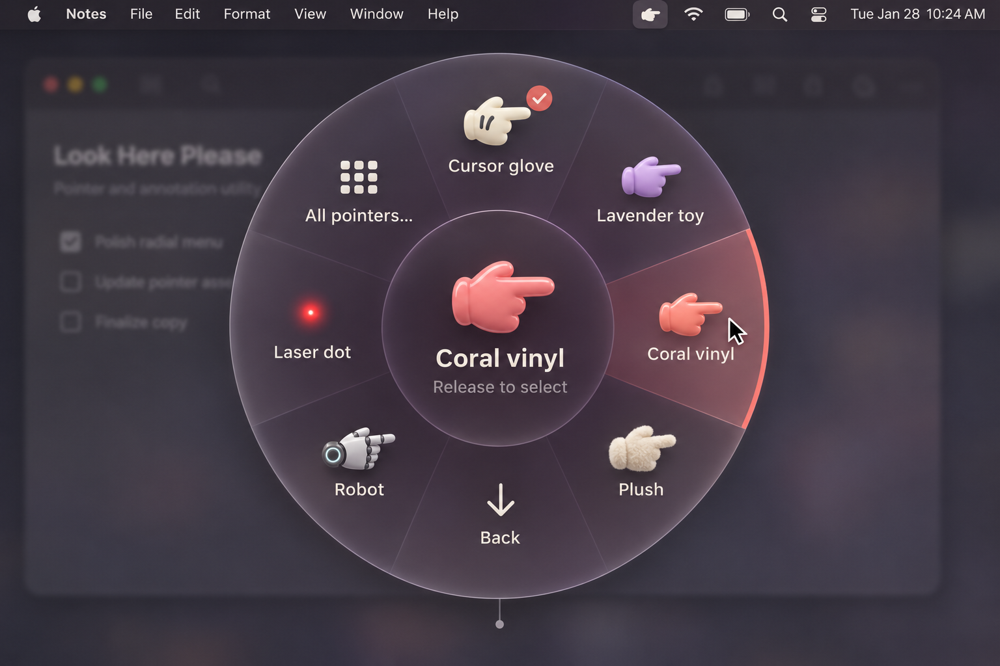
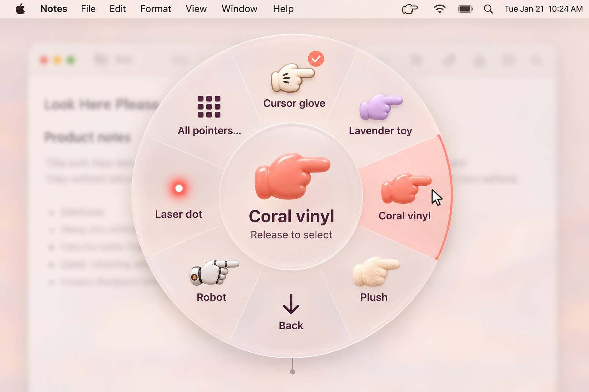

# Quick controls radial redesign

Design review by Sol, 16 November 2026. Recommendation: replace the current tile wheel with a compact directional menu. Keep six stable root commands. Show one ring at a time, start each child selection at a fresh origin, and move the full pointer collection into a visual browser.

This is a design proposal, not a runtime verification. I read the three radial source files, the glossary, the brand brief, the pointer/color/tool catalogs, and both supplied screenshots. I did not edit application source, build, launch, send input to the app, or commit. All review artifacts are in this directory. Research facts below have primary-source links. All proposed dimensions and timings are my starting specifications for local validation, not measurements of other products.

## The ten changes, ranked

1. **Make the target a direction.** Draw six equal 60° sectors and highlight the whole eligible sector. Stop placing six rectangles on an eight-direction map.
2. **Give children a fresh origin.** Replace the ring around the branch-entry point. A turn or brief pause establishes the second stroke. Do not let one straight outward movement silently become a leaf selection.
3. **Delete pointer paging.** Give Pointer six stable favorites, All pointers…, and Back. Open a searchable artwork grid for the full collection. Every enabled, available pointer remains reachable.
4. **Offer a persistent click-open mode.** Add a normal shortcut and menu-bar command that open the same controls without a sustained hold. Keep hold/release as an optional fast path.
5. **Cut the footprint.** Use a 328 pt visible diameter in a 384 pt panel. The current root disc is 416 pt across, inside a 592 pt panel, before accounting for its disconnected footer.
6. **Make the hub explain the pending result.** Show the hovered pointer or ink sample, its name, and one short instruction. Reserve the cursor's center so the selection dot never covers words.
7. **Use one restrained native glass treatment.** A regular Liquid Glass host, semantic text, modest coral hover, and a cream glove make this belong to the Mac and the app. Remove the flat gray backing and stock button plates.
8. **Separate current state from pending selection.** A small check marks the active item. A coral sector marks the prospective action. Keep “Interact” stable and show its On/Off state separately.
9. **Keep directions stable at edges.** Clamp the ring, explain any necessary center arming, and never rotate commands or warp the pointer. Provide a list fallback for genuinely small usable displays.
10. **Treat accessibility and restraint as core behavior.** Keyboard and VoiceOver access, a no-hold path, readable opaque fallbacks, Reduce Motion, and optional quiet feedback belong in the first implementation.

## Independent critique

### The current drawing disguises the interaction

`RadialGeometry.direction` always rounds into eight 45° slots. The six root items use slots 0 through 5: north, northeast, east, southeast, south, southwest. West and northwest have no command. The screenshot's empty upper-left area is an information-architecture problem expressed as layout.

The root is not actually six rectangular hit targets. Gesture selection uses an angular slot at radii 100 through 288 pt; the rectangles merely sit at radius 128. This lets the user select in blank space, but gives no visible account of why that blank space belongs to a command. Conversely, moving beyond 288 loses the selection even while staying in the same direction. The visual language promises button aiming while the state machine asks for directional aiming. See `RadialSession.swift`, lines 22–29 and 92–108.

The supplied root screenshots show near-collisions rather than a convincing rhythm. Pointer and Color, then History and Interact, crowd each other's corners. The nominal root frames do not need to intersect to look broken: there is almost no horizontal clearance at those diagonal pairs. The symbols touch the upper tile edges, and “Interact On” competes with its inline checkmark. Increasing a few margins would not fix the uneven directions or the mismatch between drawn and effective targets.

The 97%-opaque neutral disc blocks a large part of the presentation. It has no useful layering, and its unused left side looks unfinished. A separate footer repeats instructions already present in the hub. Three focal areas compete: the ring, the center, and the footer. The 16 pt selection dot is correctly at the real pointer and above artwork, but at invocation it lands directly over the center copy. Preserve the real-location feedback; redesign around it.

### Category entry and commitment are too entangled

Moving past 100 pt into a root category immediately changes the catalog. Child artwork sits at radius 216 and becomes eligible from 176 pt. The same straight trajectory can therefore mean “Color” near the root and a particular ink farther out, without a second directional decision. Opening a group is not the same intent as choosing its first aligned leaf. The drawing should make that distinction explicit.

Returning within 88 pt backs out. Paging has another separate state: after Previous or Next, the user must come inside 156 pt to arm the next page. These thresholds are invisible. “Move inward to arm” describes internal state, not a goal the person recognizes. Release in the center cancels and Escape cancels; those are good safety rules worth retaining in the held mode.

The 180 ms bare-modifier trigger is convenient for a practiced presenter but has a real cost. A modifier is also the start of an ordinary Mac shortcut. The implementation correctly cancels a pending open on ordinary input and preserves native keyboard pairs. Still, pausing after pressing Command, Option, Shift, or Control can display the menu before the intended shortcut arrives. A second modifier cancels an open menu. Keep this opt-in and provide a conventional alternative. Do not shorten the delay to make a benchmark look faster.

The current input layer cancels on ordinary keys, handles Escape specially, swallows scrolling while open, and closes on a mouse-down gesture. The nonactivating panel cannot become key and ignores ordinary mouse events. Having accessibility labels on NSButtons is useful, but does not establish that a screen-reader user can discover, focus, navigate, and commit this transient UI. Persistent mode needs a real focus and input policy, not just more AX labels.

### The collection is the wrong shape for paging

With 39 eligible pointers, six per page produces seven pages. The last page has three pointers, padding, and navigation slots. Reaching a late item may require repeated Next excursions and inward rearming while holding a key. Positions identify page indexes rather than particular pointers. Enabling, disabling, or adding an earlier pointer can change the sequence and page boundaries. Artwork is the reason to choose many of these styles, yet the current small button image is subordinate to the label.

A wheel is good for a small set of remembered choices. A visual browser is better for comparing 39 images. Artificial families such as “Soft,” “Novelty,” and “Materials” would add classification work and another hierarchy before users can see the actual hands. I would not replace seven pages with a taxonomy maze.

### Hierarchy, identity, and state

Pointer, Color, Tools, History, More are groups; Interact is a direct toggle. They look almost identical. Add disclosure marks for groups and a distinct state badge for the toggle. Rename Tools to Draw so it describes what the next action does. Keep Interact as the established product term, with “Send clicks to the app” in the hub when highlighted. Do not redefine it as pointer visibility. Those remain separate states.

The current blue outline on Interact marks an existing state. A highlighted item also gets a filled background. Those need an explicit grammar so people can tell what is already active from what will happen on release. Pointer artwork can express the brand. The basic controls should stay quiet and native.

Light mode is a gray disc with white plates; dark mode is a gray disc with black plates. Both lose the cream, coral, and plum identity. Dark mode needs its own tonal hierarchy and readable secondary text over arbitrary presentation content, rather than a reversed grayscale screenshot. No animation exists today; the diagnostics read Reduce Motion but do not by themselves provide a motion design.

### Directional selection, accessibility, and displays

For directional menus, angular tolerance and stable origins matter as much as visual target size. Equal sectors let people move in a direction without stopping on a little rectangle. A six-way ring at radius 112 has a sector chord of 112 pt; an eight-way ring has about 86 pt. These are geometric widths, not measured user-performance predictions. Wider angles alone do not prove a faster menu. Child transitions, recall, tremor, and cancellation dominate many real tasks.

The existing edge policy gets two important things right: it clamps into a single display's visible frame, and requires center arming after relocation. It does not warp the pointer or rearrange commands. Keep that safety. Its 592 pt minimum usable width and height is unnecessarily restrictive, and “Enter center” does not explain the journey from the real cursor to a shifted hub. Multiple displays, a menu bar, Dock, notch, negative global coordinates, and display removal need designed outcomes. Crossing a display boundary should never silently transfer the menu to a new origin during a held gesture.

## What the best precedents actually teach

These are documented behaviors and my transfers from them. I have not installed and timed the products. Product marketing and help pages establish intended behavior, not proven accuracy or accessibility.

| Precedent | Primary-source evidence | Transfer to Quick controls |
| --- | --- | --- |
| Kando | Point-and-click uses angular areas. Its marking path can select a step on a stop or sharp turn; turbo mode can commit on modifier release. It recommends eight items and supports fixed angles. It documents both pointer-centered and anchored submenu behavior. [Usage](https://kando.menu/usage/), [layout](https://kando.menu/creating-menus/), [configuration](https://kando.menu/config-files/) | Draw the directional target. Fix directions. Deliberately choose a child-origin model. Use its marking ideas without copying an elaborate hierarchy or invisible hover execution. |
| Loop | A native Mac direction picker shows a preview of the proposed window placement. Its source connects trigger release to closure and applies a selected action through the preview path. [Repository](https://github.com/MrKai77/Loop), [pinned commit handling](https://github.com/MrKai77/Loop/blob/e8560f458ad14c403c1629dfbe0b3bfdce0fa6a7/Loop/Core/LoopManager.swift#L349-L373) | Explain the pending result before committing. For this utility, preview a hand or ink sample in the hub without changing the live presentation. Loop is a preview precedent, not proof about deep submenu geometry. |
| Logitech Options+ Actions Ring | Eight primary bubbles, action folders, adjustment modes, Tab/Shift-Tab navigation, Enter/Space activation, and Escape/back behavior are documented. [Support](https://support.logi.com/hc/en-my/articles/17844647906967-Logi-Options-Actions-Ring) | Keep selection and continuous adjustment distinct. Make keyboard navigation and Back explicit. Do not automatically remap directions by foreground app during a presentation. |
| BetterTouchTool | Circular floating menus support pointer/screen/window anchors and expandable press-slide-release actions. Shortcut-driven showing/hiding can optionally invoke the hovered item. It documents the tradeoff between nonfocused utility menus and keyboard access. [Basics](https://docs.folivora.ai/docs/floating-menus/basics/), [show/hide](https://docs.folivora.ai/docs/floating-menus/showing-hiding/), [keyboard](https://docs.folivora.ai/docs/floating-menus/keyboard-shortcuts/) | Define invocation, focus, and commitment together. Circular placement does not by itself establish angular hit testing. |
| Pie Menu and Pieoneer on Mac | Pie Menu documents held release-to-select and persistent opening after shortcut release. Its submenus open another pie. Pieoneer's App Store description claims hold/tap paths, keyboard operation, and independently optional animations, audio, and haptics. [Opening](https://www.pie-menu.com/help/show-options), [submenus](https://www.pie-menu.com/help/whats-new), [Pieoneer](https://apps.apple.com/us/app/pieoneer/id6739781207?mt=12) | A Mac radial utility can offer both held and persistent operation. Optional feedback should remain optional. The developer's accessibility claim still needs independent testing. |
| Blender pie menus | The manual describes hold/move/release, a neutral center boundary, highlight, keyboard accelerators, and sub-pie indicators. Releasing without moving leaves a menu open for a click. [Manual](https://docs.blender.org/manual/en/4.5/interface/controls/buttons/menus.html#pie-menus) | Support visible browsing and directional use with the same layout. I would retain center-release cancellation in our held mode and use a separate explicit click-open command, avoiding a surprising new meaning for release. |
| Kurtenbach and Buxton | The 1993 hierarchy study connects visible selection to remembered marks and finds breadth/depth costs. The 1994 field study warns against changing item locations and observes experts revisiting visible menus. [1993 paper](https://www.billbuxton.com/MMExpert.html), [1994 paper](https://billbuxton.com/MMUserLearn.html) | Stable directions teach gestures. Keep visual help available. A shallow design is a better first bet here than “infinite depth.” Neither small study establishes ideal modern Mac trackpad dimensions. |
| Procreate QuickMenu | Six customizable radial buttons support tap selection and directional drag/release. Profiles provide other sets of six. The handbook describes familiarity becoming a flick. [Handbook](https://help.procreate.com/procreate/handbook/interface-gestures/quickmenu) | Small, meaningful, stable sets beat a wheel containing every feature. The six-item count is a useful precedent, not universal optimization evidence. |
| Game weapon wheels | Ubisoft documents Far Cry 6's holdless option, including a per-action hold/toggle choice for the weapon wheel, and cursor or directional menu navigation. [Developer accessibility interview](https://news.ubisoft.com/en-us/article/43Uvc8MM55rAsvq8JgaVXU/accessibility-spotlight-far-cry-6) | Borrow input flexibility. Leave slowdown, inventory density, dramatic sound, and game HUD decoration out of this Mac utility. This source does not establish precise wheel geometry or timing. |
| Apple's macOS language | Glass belongs to the transient control/navigation layer and should be restrained. `NSGlassEffectView` is available from macOS 26. The HIG stresses input alternatives, system-aware contrast, and optional motion. [Materials](https://developer.apple.com/design/human-interface-guidelines/materials), [AppKit class](https://developer.apple.com/documentation/appkit/nsglasseffectview), [accessibility](https://developer.apple.com/design/human-interface-guidelines/accessibility), [motion](https://developer.apple.com/design/human-interface-guidelines/motion) | One regular glass control is appropriate here. Give it semantic text, an opaque accessible fallback, and subdued pointer-driven feedback. Native feeling comes from behavior as much as material. |

Kando publishes 150 ms fade-in and 200 ms fade-out defaults. They are configurable settings, not measured latency or a target to copy. No verified numerical motion timings for the other products are used here. [Kando configuration](https://kando.menu/config-files/)

## Proposed design specification

### Geometry and command map

All measurements are logical points. Angles run clockwise from north. Freeze the command map during each session. Changing enabled state must not close up angular gaps or remap another command. A missing favorite keeps a disabled slot until the user explicitly replaces it.

| Property | Starting specification |
| --- | --- |
| Root visible diameter | 328 pt |
| Transparent hosting panel | 384 × 384 pt, allowing 28 pt beyond the circle on each side for shadow and containment |
| Visible ring | Inner radius 64 pt, outer radius 164 pt |
| Hub | Radius 56 pt, separated from the ring by an 8 pt quiet band |
| Neutral cancel region | Radius 52 pt |
| Selection acquisition | Radius 72 pt; once acquired, retain down to 64 pt, clear inside 64 pt |
| Branch entry | Crossing radius 112 pt in the highlighted category, measured from the current origin |
| Fresh child stroke | A turn of at least 30° from the incoming stroke, established over 16 pt, or an 80 ms pause within 24 pt of the child origin with no more than 4 pt drift |
| Root items | Six, each 60° |
| Command children | 3–8 occupied sectors, each exactly 360° / count, including Back; no generic eight-slot allocator |
| Palette exception | Ten sectors at 36°: nine current ink choices plus Back |
| Icon and label group | Center at radius 118 pt; group shifts only within its sector to preserve clearance |
| Artwork / symbol size | Pointer thumbnail 32 pt; root symbol 24 pt; other child symbols 22 pt |
| Label boxes | Root up to 84 pt wide, child up to 64 pt wide; horizontal text, at most two lines |
| Visual sector gaps | 4 pt measured at the outer radius, rounded path ends; gaps remain part of the logical angular target |
| Angular hysteresis | Retain the current sector until movement crosses its boundary by 4°; returning to neutral clears it |

The tiny 64–72 pt acquisition band prevents jitter at the hub boundary. It is a state tolerance, not another instruction to show. The sector highlight and hub always reflect the actual candidate. Disabled sectors never become candidates. At an exact unowned angular boundary, choose the clockwise sector deterministically; while a candidate exists, hysteresis takes precedence.

| Root direction | Label | Type and hub explanation |
| --- | --- | --- |
| 0°, north | Pointer | Group. “Choose a style” with the current hand thumbnail. |
| 60°, northeast | Color | Group. “Drawing ink” with a short sample stroke. |
| 120°, southeast | Draw | Group. “Choose a drawing tool.” |
| 180°, south | Interact | Direct toggle. Existing state shown as On/Off and check badge. Pending result says “Turn Interact off” or “Turn Interact on.” |
| 240°, southwest | History | Group. “Undo, redo, or clear.” |
| 300°, northwest | More | Group. “Presentation controls.” |

Direct command labels remain stable. Use a small disclosure chevron for every group. Keep the user's current state visible through a check badge and words; do not prepend a checkmark into the label's text layout.

### Children replace the ring and establish a new origin

Do not keep a root ring plus a permanent outer ring. Do not expand the panel into a 568 pt child disc. Do not replace the catalog at the same origin and let the old outward motion choose a new leaf.

On crossing 112 pt into a category, establish the child origin at the interpolated crossing point. Replace the root with the child ring there. Consume that crossing sample as navigation only. A child starts with no candidate and requires a fresh stroke: either turn at least 30° from the incoming movement, with 16 pt establishing the new heading, or pause for 80 ms within 24 pt of the child origin with no more than 4 pt drift. Then at least 72 pt of movement from the child origin is required for a leaf. There is no required dwell for a bent marking gesture and no cursor warp. A visible menu and a practiced two-stroke gesture use exactly this same path.

In the Pointer example, moving north enters Pointer. Turning east from the new origin establishes a fresh stroke and highlights Coral vinyl at 72 pt. Release chooses it. To choose the forward Cursor glove, pause at the child hub, then move north again. Continuing straight north without that pause produces no leaf candidate and release cancels. The neutral hub can say “Turn or pause to choose” until the fresh stroke is established. This is an intentional safeguard against accidental straight-through selection. If one large/coalesced input sample crosses both thresholds, it may enter the child but cannot commit a child until subsequent input establishes a fresh stroke and candidate.

Back occupies a real sector in the nominal direction of the parent. Other child sectors divide the circle evenly as part of that same equal-sector layout. For an N-sector child, set Back's center to the reverse of the parent category's fixed axis, then place the other sectors in increments of 360°/N. Use the category axis, never the measured incoming stroke angle. Thus Pointer's Back is always south, even if the person entered Pointer slightly northeast. The child origin follows the actual crossing point, but its item angles stay fixed. Child counts can differ; item positions cannot drift during use.

Back is navigation, not a leaf. Entering its sector at 60 pt returns to the saved parent, clears the candidate, and requires fresh outward movement. Back does not require a pause or a newly armed leaf stroke. Returning within 52 pt of the actual parent origin also backs out, checked before leaf selection, provided the two origins are at least 104 pt apart. If edge clamping brings them closer, use the explicit Back sector instead; overlapping neutral regions must not immediately undo child entry. Consume the Back event as navigation only. There is no competing offscreen breadcrumb button. At any depth, release in the neutral center cancels the entire held session. Escape cancels the entire held session. Persistent mode also has an explicit Back target; Escape steps back once, then closes at root. These differences follow the invocation mode and must be announced to assistive technology.

Ship at most one child level in the radial control. Deeper data opens a native panel. Keep a parent-stack representation so Back is coherent, but do not expose an unlimited hierarchy just because it can be modeled. This differs from Kando's enthusiasm for deep menus and follows the needs of this small utility.

The turn/pause gate applies only to held gesture selection. In persistent mode, clicking a group opens the child at that click position, clamped to the safe area, and the next distinct click can choose a leaf. Keyboard or AX opening uses a child origin 112 pt along the group's fixed axis and focuses the child group; pointer arming never blocks keyboard or AX activation. Except for Pointer's explicit map below, child items follow their stated order clockwise immediately after Back. The orientation is saved as part of each category map.

The proposed reanchoring is a material interaction change and the highest-risk part of this spec. It must be tried with a mouse and a trackpad before adoption. If testing finds it disorienting, the fallback is an explicit click-entered, same-origin replacement with neutral rearming, never an unannounced same-stroke leaf selection.

### Directional hit testing and commitment

In held mode, eligible sectors extend angularly beyond the visible rim to the current display boundary. There is no artificial 288 pt cutoff. The user aims a direction, not the perimeter. Show the appropriate sector and hub preview even when the pointer is beyond the drawn circle. The center and Escape remain reliable cancellation paths. While the pointer is on a different display or outside the owned display's usable region, clear eligibility and show “Return to this display”; release cancels there.

Persistent mode uses the same sectors within the visible ring; clicking outside the control dismisses it. It does not turn a click on unrelated content halfway across the display into a command. Keyboard focus and AX focus use the same highlighted/pending state as pointing.

Highlight never changes the live drawing tool, pointer, or ink. Preview is inside the hub. Release/click/Return commits exactly once through the existing validated command bridge. Revalidate availability at commit. If it changed, keep the previous application state and show an explicit unavailable result. Finish input ownership for the claimed gesture so the dismissing click cannot draw or click through to the underlying app.

### Pointer: favorites for speed, the library for choice

Use eight sectors, each 45°. Defaults when entering from north:

| Angle | Item |
| --- | --- |
| 0° | Cursor glove |
| 45° | Lavender toy |
| 90° | Coral vinyl |
| 135° | Plush |
| 180° | Back |
| 225° | Robot |
| 270° | Laser dot |
| 315° | All pointers… |

These are six dedicated Quick controls favorite slots, initially seeded with the existing six default pinned styles. The default order above is intentional and fixed. They are not a live “recent” list and do not silently mirror an unlimited toolbar list. Offer “Use first six toolbar pins” as an explicit setup action, and let the person replace/reorder the six slots in the pointer library. Explain that these slots are Quick controls favorites. Never auto-promote a newly used pointer into someone else's learned direction.

An unavailable or disabled favorite stays in its slot with a readable name and unavailability explanation, but cannot commit. An unpinned current pointer still appears in the root hub and library with its current-state check. Pins do not limit the library. Selecting a radial favorite does not change pointer enablement, library order, or toolbar membership.

All pointers… is a deliberate leaf command. On release, dismiss the held session and open a persistent native pointer browser. The release is fully drained before the browser accepts its next click. No one needs to hold a modifier while searching or comparing artwork.

The browser starts at 560 × 600 pt, with a search field, All / Favorites filter, and a seven-column artwork grid. Use 64 × 72 pt cells with 8 pt gaps. Seven columns occupy 496 pt, leaving 32 pt side margins; six rows occupy 472 pt. At least 42 cells fit within the intended grid, covering the current 39 styles without Next/Previous pages on a sufficiently tall display. Use 36 pt artwork, readable two-line labels, a check for the selected style, and a footer showing the full focused name. Long names may truncate in the small cell but must remain available in the footer and AX label. Do not shrink labels to make them fit.

Search filters immediately by actual style name. All preserves catalog order. Custom hands stay reachable. A smaller display reduces columns and uses a standard scroll view. Arrow keys move spatially; Return selects and closes; Escape closes without change. A separate favorite control changes a slot without selecting the pointer. Do not make hover preview alter the pointer shown to a meeting audience. A larger in-panel thumbnail is sufficient.

Pointer Off remains in More, with its existing independent meaning. Do not consume another favorite slot for it or merge it with Interact.

### Color: show ink, not ten palette icons

The task description and source differ. `InkChoice` currently has nine total entries: Match the pointer, Red, Orange, Yellow, Green, Blue, Purple, White, Black. It does not contain a separate rainbow/multicolor-ink operation. The palette symbol is not evidence that such an operation exists.

Use a ten-sector, 36° child: those nine entries plus Back. Arrange them clockwise beginning immediately after Back in this stable order: Match the pointer, Red, Orange, Yellow, Green, Blue, Purple, White, Black. The Back sector points toward the Color parent. A palette is the one justified exception to the normal eight-sector maximum because a recognizable swatch takes less visual decoding than an arbitrary command or detailed hand image.

Each sector contains a 28 pt swatch with a 1 pt contrast rim and a short 11 pt label. Black and White need visible boundaries in both appearances. Match uses a miniature hand plus linked color chip, and resolves to the current pointer's ink in the hub preview. Do not use a rainbow chip unless it genuinely means multicolor ink. If multicolor is later added, reopen this layout decision rather than silently appending an eleventh sector.

The hub displays the full color name and a 36 × 8 pt sample stroke, with the pointer-match relationship stated when relevant. Keep the selected check outside the sample, using a two-tone badge so it reads over yellow, white, and black. Coral hover is an outline/outer arc here, with a neutral interior wash, so it does not distort the swatch. Color names and the selected check carry meaning without hue alone.

No freeform color picker belongs in the held gesture. If custom ink is added later, an explicit Custom… leaf should open a persistent native color panel.

### Other children and command semantics

Draw has eight sectors: Pen, Highlighter, Rectangle, Arrow, Text, Number, Eraser, and Back. Preserve those directions even if a tool becomes temporarily unavailable. The hub says “Draw with Pen,” for example, and explains that committing a drawing tool exits Interact. The current drawing tool can have a check while inactive; label its status “Last used” when Interact is on rather than implying drawing is currently capturing clicks.

History has four 90° sectors: Back, Undo, Redo, Clear drawing. Keep unavailable Undo/Redo visible. The hub explains “Nothing to undo,” and no highlighted candidate exists for a disabled command. Clearing drawings must be one undoable operation. If the underlying model cannot restore a clear operation, remove it from release selection until that behavior is implemented. A destructive confirmation dialog in the middle of a quick gesture would be a poor substitute.

More has seven equal sectors, about 51.43° each: Back, Screenshot, Tap sound, Mute all sounds, Show toolbar, Settings…, Pointer off. Keep their item directions fixed for this category. Show a state badge for each toggle. “Show toolbar” may display a stable “Toolbar” label with On/Off state if the underlying action can remain clear. Settings… dismisses the ring before presenting Settings. Screenshot dismisses all Quick controls and feedback layers before capture so neither appears in the result. Do not add Quit to the wheel.

### Invocation, novice use, and expert use

Keep the current opt-in bare-modifier trigger and 180 ms delay as a compatible held mode. Keep ordinary input cancelling a pending open, sampled stale releases cancelling rather than selecting, and existing key-pair ownership protections. The current pending position follows pointer movement; preserve that behavior so a delayed open begins at the actual invocation position. Do not replay pre-open movement as an expert mark. That could execute a menu gesture during an ordinary shortcut.

Add a configurable normal shortcut named Open Quick controls and a visible menu-bar command. Its persistent mode opens immediately and accepts clicks, Tab, arrows, Return, Escape, and accessibility actions. Choose invocation mode explicitly. Releasing at center in held mode continues to cancel, while pressing the persistent command does not require holding anything.

A first-use hint can occupy the hub: “Move to a group” and “Release at center cancels.” Show only one relevant instruction at a time. Hide repetitive teaching after successful use and keep it in Help. Do not add a footer to preserve instructions indefinitely.

Expert use is a learned directional sequence using the same visible geometry: hold, move north, move east, release. Do not hide the menu based on an inferred skill level. Once this model has been validated, a user-selected delay before drawing the visual menu could be investigated, but it is not part of this first spec. A fully blind, pre-180 ms recognizer is out of scope.

### Rendering and brand

Use one circular regular Liquid Glass host on macOS 26. `NSGlassEffectView` provides a native content host, corner radius, tint, and interactive-effect controls; do not assume arbitrary custom annular glass masking is supported by that API. A circular host with drawn sector overlays and a hub inside it avoids needing separate glass wedges. A SwiftUI implementation can use one glass shape with ordinary drawing inside. [AppKit API](https://developer.apple.com/documentation/appkit/nsglasseffectview), [AppKit adoption session](https://developer.apple.com/videos/play/wwdc2025/310/)

Do not stack six glass controls on a glass disc or add a second glass layer for the hub. Draw the hub's separation with a quiet fill and hairline inside the same host. Allow the presentation to show through with controlled diffusion, not legible moving text behind the labels. Use regular rather than clear glass, and honor the system's selected material appearance. These are transient controls over arbitrary work, not a media player's clear overlay. [Apple materials guidance](https://developer.apple.com/design/human-interface-guidelines/materials)

Use the actual app's cream glove and existing pointer artwork. The root Pointer thumbnail is the current style; the default hub may use the original brand glove. Keep the other root icons monochrome SF Symbols. No custom novelty icon set is needed. Use the existing branded coral as a selection-family starting point, with a deeper light-mode variant and lighter dark-mode variant. Plum is an undertone and opaque-fallback neutral, not a saturated ring fill.

| Treatment | Light appearance reference | Dark appearance reference |
| --- | --- | --- |
| Opaque fallback background | `#F8F5F1` warm neutral | `#29242D` plum charcoal |
| Primary fallback text | `#302736` | `#F6F0E8` |
| Secondary fallback text | `#645B68` | `#C3B9C8` |
| Hover fill reference | `#F9DDD4` | `#503139` |
| Hover arc reference | `#B6423B` | `#FF9589` |
| Glove | Cream artwork with plum edge/cuff | Cream artwork with plum edge/cuff |

These hex values are proposed brand references and opaque-fallback tokens, not copied values of AppKit semantic colors. In normal glass rendering use `labelColor`, `secondaryLabelColor`, and material-aware system treatment. Blend control backgrounds and selection fills to preserve contrast over busy content. Do not claim a rendered glass contrast ratio from the opaque references alone. [Apple color guidance](https://developer.apple.com/design/human-interface-guidelines/color)

Local calculation of the opaque references gives light primary 13.15:1, light secondary 5.97:1, dark primary 13.40:1, and dark secondary 8.01:1 against their fallback backgrounds. Primary text against the proposed hover fills gives 11.11:1 light and 10.08:1 dark. These are WCAG relative-luminance calculations for solid sRGB pairs only; no live material was sampled.

Idle sectors have no button plate. Hover fills the angular area gently and adds a 2 pt outer arc. The current selection has a small two-tone check badge and a 1 pt local state ring around its thumbnail. Current state stays visible even when another sector is hovered. Keyboard/AX focus adds a distinct system focus outline, not just a second shade of coral. Disabled commands keep their slot, use readable secondary treatment, have no hover fill, and explain the reason in the hub. Never express disabled state with opacity alone.

Use a restrained native shadow, starting at 0, 8 pt offset, 20 pt blur, about 16% black in light and 28% in dark. Let the native material edge do most of the work. Do not draw a bright 3D bevel, outer glow, or a screen-wide dimming layer. At 1× scale align hairlines to the backing pixel grid. Glove art may be playful; control chrome should be quiet.

### Hub, cursor marker, and type

The real selection marker is an 8 pt hollow dot with two opposing high-contrast strokes and a 2 pt open center. Keep it at the real pointer location. Hide the app's large decorative hand during the menu, restoring it on close; otherwise the hand and selection marker compete. Do not draw a second system arrow plus a custom selection dot at the same point. Respect enlarged system-pointer settings and offer the normal system pointer in persistent mode.

Reserve a 20 × 20 pt region around the exact origin whenever the marker is in the hub. At neutral, put “Quick controls” above that reserve and “Release cancels” below. Never place a label under it. Once a sector is highlighted and the pointer has left the hub, the hub can use that area for its larger hand or stroke preview. Preview content changes within the hub; the hub never chases the pointer.

Use system typography. Root labels are 13 pt medium with 16 pt leading. Child labels are 12 pt medium with 15 pt leading. Palette labels and short hints are 11 pt regular with 14 pt leading. Hub title is 13 pt semibold and its instruction 11 pt regular. The enlarged preview artwork can be 36 pt, but command names remain Mac-sized. Avoid all caps, outlined text, radial text rotation, and condensed fonts. Apple's macOS default text size is 13 pt and documented minimum is 10 pt; this design intentionally keeps all necessary text at 11 pt or above. [Accessibility HIG](https://developer.apple.com/design/human-interface-guidelines/accessibility)

### Motion, feedback, and Reduce Motion

These timings are proposed values for this app. Logical selection and command execution never wait for an animation to finish.

| Event | Normal starting behavior | Reduce Motion |
| --- | --- | --- |
| Open | 120 ms ease-out opacity, optional scale 0.98 to 1.00; no bounce or stagger | 80 ms opacity only, no scale |
| Hover change | 60 ms fill crossfade; new sector highlight appears directly, never sweeps across intervening commands | Immediate highlight |
| Hub preview | 80 ms opacity change; fixed frame | Immediate replacement |
| Child entry | Reanchor immediately at the new origin; replace the old ring, show the new material immediately, then settle content opacity over 100 ms; no visible 112 pt disc travel | Immediate reanchor and replacement |
| Back | Restore the saved parent origin immediately, 80 ms content crossfade | Immediate replacement |
| Commit | Execute immediately; 80 ms opacity dismissal | Immediate dismissal or up to 50 ms opacity |
| Cancel | 80 ms opacity dismissal | Immediate dismissal |

Use a nonovershooting ease-out, starting with cubic control points 0.2, 0, 0, 1. The ring must not rotate, orbit, spring into sectors, inflate on every hover, or produce lens distortions that move text. Pointer input deserves subdued response. Avoid motion-based teaching when Reduce Motion is on. [Apple motion guidance](https://developer.apple.com/design/human-interface-guidelines/motion)

Menu sound is off by default. If enabled, one quiet confirmation on successful commitment is enough. No sound on every sector crossing, no cancel error beep, and no cartoon swoosh. Menu feedback respects Mute all sounds independently of the pointer's tap-sound preference. An optional single trackpad alignment haptic on branch entry or commitment may help; avoid both if they feel redundant. Use the system performer, which accounts for current device and preferences, and do not assume mice or external trackpads can vibrate. Haptics cannot be the only feedback. [NSHapticFeedbackManager](https://developer.apple.com/documentation/appkit/nshapticfeedbackmanager)

For routine changes, a compact 1.2-second result label can replace the hub during dismissal and then fade. It must not reintroduce a full-width footer. Errors remain available in a persistent accessible result panel rather than disappearing after the current 0.65-second toast. Clear drawing needs persistent Undo access beyond any toast. Success feedback must not delay taking a screenshot or appear inside it.

### Accessibility and keyboard behavior

Persistent mode is the default path for VoiceOver, Switch Control, Full Keyboard Access, and anyone who chooses no-hold operation. Make its panel key-capable without switching the utility into a regular Dock app. Store and restore the prior responder/application focus on close. Held mode remains nonactivating, and unrelated ordinary keyboard input still cancels and passes through. Do not make a global event tap swallow VoiceOver's Control-Option commands.

Expose a labeled menu/group with real accessible elements, names, state, enabled status, branch relationship, and press actions. Pointer items announce “Cursor glove, selected”; groups announce that they open choices; Back announces its destination. The marker, artwork decoration, and sector-divider paths are not separate AX elements. A drawn sector may have a rectangular AX frame, but its activation must call the same command route as gesture selection. Rebuilding the candidate must not destroy AX identity or focus on every mouse move.

On opening, announce “Quick controls, six items.” Put keyboard focus on the root group, with no dangerous default action. Tab/Shift-Tab cycle items clockwise/counterclockwise; Left/Right cycle the same order. Up/Down may also cycle for consistency, rather than inventing six-way arrow combinations. Return or Space opens a group or commits a leaf. Escape backs out in persistent mode and closes at root. Backspace also goes to the parent. Expose Back as a focusable element, so no keyboard shortcut is required to discover it. In the pointer library, arrows instead navigate its two-dimensional grid.

Announce focus changes, not every pixel of pointer movement. Announce commit and error results. Keep all commands reachable through conventional menu-bar controls as well. Support Voice Control names with unique visible labels. Do not infer accessibility success from the current NSButton labels.

Use at least 4.5:1 for small text and 3:1 for essential nontext marks against their immediate background, with the solid fallback used whenever glass cannot maintain legibility. Check live light, dark, Increase Contrast, and Reduce Transparency appearances over both bright slides and busy imagery. Color names and checks supplement hue. Increase Contrast strengthens dividers and state marks; Reduce Transparency switches to the opaque palette. Larger-text operation should use a scrollable native command list rather than shrinking or clipping the wheel's labels. [Apple accessibility guidance](https://developer.apple.com/design/human-interface-guidelines/accessibility)

### Edges, multiple displays, and constrained sizes

Choose the display containing the invocation pointer. Work entirely in global logical points, then convert through that display's backing scale for drawing. Inset its usable frame by 192 pt to place the 384 pt panel. Account for menu bar, Dock, and any screen-safe area. At a corner, clamp the center to this safe rectangle. Do not shrink the geometry, rotate sectors, use a semicircle, or warp the cursor.

If clamping shifts the center by more than 8 pt, start unarmed. Show a short line from the real cursor toward the neutral hub and “Move to center” above the reserved origin. Until the user enters radius 52, no candidate can commit and release cancels. Remove the line once armed. It is a journey cue, not a second footer or a dot that snaps away from the real cursor.

For a child, try its natural crossing-point origin, then clamp to the same safe rectangle. If the adjustment exceeds 8 pt, require child center arming before any child leaf becomes eligible. Entering radius 52 after this relocation counts as a deliberate reset; the subsequent outward stroke can choose any child direction without the turn/pause gate. Clear all pre-arming travel. This makes the expert path slower at an edge, but keeps the direction map and prevents accidental selection. Preserve the parent origin for Back, and apply the overlapping-origin rule above. Do not relocate an already armed ring repeatedly as the user moves.

One session belongs to one display. Crossing to another display clears the candidate and does not transfer ownership or execute. If the invocation display disappears, or a resolution/space transition invalidates the safe layout, cancel. The next invocation can use the new display configuration. Keep screenshot scope tied to the display policy already defined by the app, not an incidental panel position.

If either usable display dimension is below 384 pt, present a compact native command list instead of an error saying the wheel cannot open. Keep the same hierarchy and labels. Clamp the persistent pointer browser to the visible frame with at least 16 pt outside margin; reduce grid columns and use standard scrolling. No UI needs a 592 pt minimum simply to expose the commands.

### Delete from the old design

- The six-on-eight root allocator and the empty west/northwest directions.
- Generic rounded NSButton plates and their `.imageAbove` content layout.
- The 97%-opaque flat disc, disconnected help footer, and duplicate summary.
- The radius-216 outer catalog and fixed 288 pt selection ceiling.
- Previous, Next, pointer page counters, padded pointer-page slots, and `pageArmed` interaction.
- Inline “✓ ” title prefixes, and the idea that current state and pending selection use interchangeable decoration.
- The unannounced same-origin category-to-leaf continuation.
- Any dependency on holding a modifier to browse all artwork or use assistive technology.

Keep the validated control bridge, session identity checks, input-pair draining, ordinary-input pending cancellation, history availability updates, center cancellation, and the no-warp principle. These are useful behavior, independent of the drawing.

## Concept renders

These four 1536 × 1024 PNGs were made with the built-in image-generation tool. They are visual concepts, not pixel specifications or screenshots of a running build. They show the chosen root and Pointer child in both appearances.

The local [concept gallery](concepts.html) compares root and child and switches between appearances. It was checked with T3's HTML preview. PNG signatures and chunk checksums, Markdown code fences, and local links were also checked locally. These artifact checks do not validate the proposed app behavior.

| Image | Intent |
| --- | --- |
| [concept-root-dark.png](concept-root-dark.png) | Six equal root directions, a quiet dark glass control, coral pending selection. |
| [concept-root-light.png](concept-root-light.png) | Warm light material, readable plum text, cream glove, restrained color. |
| [concept-pointer-dark.png](concept-pointer-dark.png) | Eight child sectors, actual-style thumbnails, checked current item versus hovered candidate. |
| [concept-pointer-light.png](concept-pointer-light.png) | The same pointer choices with a bright material and visual library entry. |









The renders exaggerate scale, hub size, glass gloss, and selection brightness for presentation. The child images use a system-arrow-like cursor instead of the specified hollow marker; the root images make the check badge coral rather than the specified two-tone state mark. Their tiny parent anchor outside the child circle is illustrative and geometrically wrong for a parent only 112 pt away. Omit it in implementation; the Back sector itself identifies the parent direction. The generated menu-bar chrome, dates, typography, glove art, separator gaps, and blur are not assets or implementation guidance. The written geometry, contrast requirements, actual pointer artwork, and input behavior above take precedence.

## What still needs local validation

This review did not run application tests or a usability study. Do not report the proposed menu as faster, accessible, or production-ready based on these renders.

The first local prototype should answer four questions before visual polishing continues: does a moving child origin and the turn/pause distinction feel predictable, does 112 pt create enough deliberate branch entry, can the denser ten-sector palette be selected reliably on a trackpad, and is the shifted-center cue understandable at display corners? Compare held and persistent use with actual pointer names, not compass labels. Keep the first-session learning and repeat-session behavior separate.

The implementation acceptance set should cover the following:

- Six equally spaced root commands with correct visible highlight throughout each logical sector; no overlapping label/artwork frames at 1× or 2×.
- No child leaf can commit on the root-entry sample. Center release, Escape, second-modifier cancellation, and stale release reconciliation never execute an action.
- Fast outward overshoot retains a valid direction within the owned display; a boundary crossing or outside persistent-mode click does not commit.
- All 39 current pointer styles, custom hands, unpinned styles, and future catalog growth stay reachable with search and scrolling, without paging or changing favorite directions.
- Disabled/missing favorites and changing Undo availability remain in place and give correct reasons.
- Pointer Off, Interact, current drawing tool, and current ink retain their independent established meanings.
- Center arming at every corner, menu-bar and Dock edges, mixed Retina scales, negative-coordinate displays, unplugged monitors, and full-screen spaces cancels safely.
- VoiceOver can open, discover, navigate, choose, go Back, cancel, hear the result, and recover previous focus. Full Keyboard Access and Voice Control work through actual accessible actions.
- Light/dark, Increase Contrast, Reduce Transparency, Reduce Motion, enlarged pointer, and larger-text list fallback remain legible over real presentation content.
- Screenshot contains neither wheel nor feedback. Clear drawing has working Undo. A click used to dismiss cannot annotate or click through.

Measure errors, corrective movement, successful completion, and time after people understand the task. Timing a practiced north/east gesture alone would miss the browsing and edge cases that currently make this menu awkward. All builds and validation must happen locally on Austin's Mac; hosted CI remains disabled.

## Image generation prompts

The four requests used the built-in image-generation tool, with opaque backgrounds. Each prompt combined the following common direction, one layout block, and its appearance block. The combined text was supplied verbatim; no source screenshots were used as edit targets.

### Common direction

```text
Use case: ui-mockup. Asset type: high-fidelity macOS 26 radial menu concept render for Look Here Please, a playful native menu bar pointer and annotation utility.
Create one polished product-design concept image, landscape 1536x1024. It is a straight-on screen capture style view, never a perspective device mockup.
The menu is a compact, exquisitely crafted floating circular control with ONE contiguous regular Liquid Glass material, soft restrained rim, convincing subtle background transmission, delicate shadow, and a small circular hub. Flat technical precision with a warm human brand. Cream pointing glove artwork, restrained coral selection accent, quiet plum undertone. Native SF Pro-like typography and SF Symbols-like simple glyphs.
Menu diameter roughly 700 image pixels so all contents read clearly, representing 328 logical points at 2x. Inner hub diameter roughly 240 pixels, representing 112 logical points. Ring extends from logical radius64 to164. Labels stay horizontal. Everything is centered in its own angular sector with ample padding. There are no rectangular buttons, pills behind each item, floating labels outside the ring, footer, game HUD ornament, neon, rainbow glass, heavy beveled 3D, enormous branding, or window chrome.
Underlying Mac desktop is softly defocused and quiet, only to show this is a transient menu over real work. No full-screen black scrim. The ring remains sharply legible. Accurate readable text is essential. Do not add extra menu commands. Concept quality, not an implementation screenshot.
```

### Root layout

```text
EXACT ROOT GEOMETRY: six equal 60-degree pie sectors. One sector centered at 12 o'clock, then five evenly spaced clockwise at 2,4,6,8,10 o'clock. The annular sectors are visually separated by fine radial hairlines with 4 logical point gaps, rounded ends, sharing the same circular glass backing. The selection uses a quiet coral-tinted annular sector with a stronger thin coral outer arc, not a rectangle.
At 12 o'clock: a beautiful miniature cream pointing glove above the exact label "Pointer", tiny disclosure chevron, hovered and highlighted with coral.
At 2 o'clock: monochrome palette glyph above "Color", tiny disclosure chevron.
At 4 o'clock: monochrome pencil glyph above "Draw", tiny disclosure chevron.
At 6 o'clock: monochrome arrow cursor glyph above "Interact", a small separate checkmark badge indicating current On state. Keep text label stable.
At 8 o'clock: monochrome undo glyph above "History", tiny disclosure chevron.
At 10 o'clock: monochrome ellipsis glyph above "More", tiny disclosure chevron.
Hub: small cream glove preview centered in upper half, exact title "Pointer" in 13pt semibold look below it, exact subtitle "Choose a style" in smaller type below. All hub content has room and does not touch ring items. Small high-contrast hollow selection dot positioned near the Pointer sector, away from labels.
No instructions or summary pill outside the ring.
```

### Pointer child layout

```text
EXACT POINTER CHILD GEOMETRY: eight equal 45-degree annular sectors, not six. This child replaces the root, so ONLY ONE ring is visible. A tiny faint parent anchor dot 112 logical points below the child center and a very short fine connector visible outside the bottom rim may suggest the previous origin, but no second ring.
Clockwise starting at 12 o'clock:
12: miniature cream glove artwork, exact label "Cursor glove", small separate current-selection checkmark badge.
1:30: miniature lavender toy pointing hand artwork, exact label "Lavender toy".
3: miniature coral vinyl pointing hand artwork, exact label "Coral vinyl", this sector is hovered with gentle coral tint and thin coral outer arc.
4:30: miniature soft cream plush pointing hand artwork, exact label "Plush".
6: simple arrow-down return glyph, exact label "Back".
7:30: miniature robotic pointing hand artwork, exact label "Robot".
9: simple glowing red laser-dot thumbnail, exact label "Laser dot".
10:30: small grid glyph, exact label "All pointers…".
Every thumbnail roughly32 logical points and every label around12pt, horizontally centered with safe padding. No thumbnail intersects a sector edge.
Hub: a larger coral vinyl pointing hand preview in upper half, exact title "Coral vinyl", exact subtitle "Release to select". The small high-contrast hollow cursor marker is in the right highlighted sector and covers no label or artwork. Show the checked Cursor glove and hovered Coral vinyl as distinct states.
No paging commands. No off command in this child. No extra subrings or footer.
```

### Appearance blocks

```text
concept-root-dark:
APPEARANCE: dark macOS appearance. Dark neutral glass with a subtle plum undertone, warm off-white primary text, readable gray secondary text. Quiet charcoal desktop with a blurred document window. Coral highlight is restrained and luminous, never neon.

concept-root-light:
APPEARANCE: light macOS appearance. Luminous warm neutral translucent glass, deep plum-black primary text, readable muted plum secondary text. Warm cream desktop and faint blurred document window. Coral highlight is pale with deep coral outline. No washed-out white text.

concept-pointer-dark:
APPEARANCE: dark macOS appearance. Dark neutral glass with a subtle plum undertone, warm off-white primary text and legible secondary gray. Quiet charcoal desktop with a faint blurred document window. Coral highlight restrained, not neon.

concept-pointer-light:
APPEARANCE: light macOS appearance. Luminous warm neutral translucent glass with deep plum-black primary text and readable secondary plum. Warm cream desktop with faint blurred document window. Pale coral hover fill with deep coral outer arc. No washed-out white text.
```

The child prompt's parent-anchor instruction contradicts its stated geometry; this was caught in review and is explicitly excluded from the implementation spec. The renders remain useful material and composition concepts. No editing or image postprocessing was used to disguise the mismatch.

## Sources

Primary product documentation and original research, consulted 16 November 2026. Links in the body identify which claims they support. Unversioned product help pages can change. The Loop code link is pinned to a development commit and is not verification of a shipping release. Supporting research notes are in [RESEARCH-NOTES.md](RESEARCH-NOTES.md).

1. Kando, [How to use Kando](https://kando.menu/usage/).
2. Kando, [Creating menus](https://kando.menu/creating-menus/).
3. Kando, [Configuration files](https://kando.menu/config-files/).
4. Loop, [official repository](https://github.com/MrKai77/Loop).
5. Loop, [release callback](https://github.com/MrKai77/Loop/blob/e8560f458ad14c403c1629dfbe0b3bfdce0fa6a7/Loop/Core/Observers/KeybindTrigger.swift#L56-L60) and [commit handling](https://github.com/MrKai77/Loop/blob/e8560f458ad14c403c1629dfbe0b3bfdce0fa6a7/Loop/Core/LoopManager.swift#L349-L373).
6. Logitech, [Logi Options+ Actions Ring](https://support.logi.com/hc/en-my/articles/17844647906967-Logi-Options-Actions-Ring).
7. BetterTouchTool, [floating-menu basics](https://docs.folivora.ai/docs/floating-menus/basics/).
8. BetterTouchTool, [showing and hiding](https://docs.folivora.ai/docs/floating-menus/showing-hiding/).
9. BetterTouchTool, [keyboard shortcuts](https://docs.folivora.ai/docs/floating-menus/keyboard-shortcuts/).
10. Pie Menu, [show options](https://www.pie-menu.com/help/show-options).
11. Pie Menu, [version 2 and submenus](https://www.pie-menu.com/help/whats-new).
12. Pieoneer, [developer App Store description](https://apps.apple.com/us/app/pieoneer/id6739781207?mt=12).
13. Blender 4.5, [pie menus](https://docs.blender.org/manual/en/4.5/interface/controls/buttons/menus.html#pie-menus); [official manual source](https://projects.blender.org/blender/blender-manual/raw/branch/main/manual/interface/controls/buttons/menus.rst) used when the HTML reader failed.
14. Kurtenbach and Buxton, 1993, [The limits of expert performance using hierarchic marking menus](https://www.billbuxton.com/MMExpert.html).
15. Kurtenbach and Buxton, 1994, [User learning and performance with marking menus](https://billbuxton.com/MMUserLearn.html).
16. Procreate, [QuickMenu handbook](https://help.procreate.com/procreate/handbook/interface-gestures/quickmenu).
17. Ubisoft, 2021, [Accessibility spotlight: Far Cry 6](https://news.ubisoft.com/en-us/article/43Uvc8MM55rAsvq8JgaVXU/accessibility-spotlight-far-cry-6).
18. Apple, [HIG materials](https://developer.apple.com/design/human-interface-guidelines/materials).
19. Apple, [NSGlassEffectView](https://developer.apple.com/documentation/appkit/nsglasseffectview).
20. Apple, WWDC25, [Build an AppKit app with the new design](https://developer.apple.com/videos/play/wwdc2025/310/).
21. Apple, [HIG accessibility](https://developer.apple.com/design/human-interface-guidelines/accessibility).
22. Apple, [HIG motion](https://developer.apple.com/design/human-interface-guidelines/motion).
23. Apple, [HIG color](https://developer.apple.com/design/human-interface-guidelines/color).
24. Apple, [HIG pointing devices](https://developer.apple.com/design/human-interface-guidelines/pointing-devices).
25. Apple, [NSHapticFeedbackManager](https://developer.apple.com/documentation/appkit/nshapticfeedbackmanager).

Local evidence:

- [RadialMenu.swift](../../../Sources/TinyHand/RadialMenu.swift), especially item catalog, release behavior, canvas rendering, accessibility labels, and feedback toast.
- [RadialSession.swift](../../../Sources/TinyHand/RadialSession.swift), especially fixed slots, geometric thresholds, paging, and backtracking.
- [RadialInput.swift](../../../Sources/TinyHand/RadialInput.swift), especially the 180 ms hold, ordinary-input cancellation, event ownership, and stale-release reconciliation.
- [GLOSSARY.md](../../../docs/GLOSSARY.md), Radial menu, Selection dot, Center arming, Backtracking, Pointer page, Interact.
- [BRAND.md](../../s024/BRAND.md), cream glove, coral, plum, and native playful identity.
- [PointerStyle.swift](../../../Sources/TinyHand/PointerStyle.swift), [PointerCatalog.swift](../../../Sources/TinyHand/PointerCatalog.swift), [Preferences.swift](../../../Sources/TinyHand/Preferences.swift), [DrawingModel.swift](../../../Sources/TinyHand/DrawingModel.swift), current counts and command semantics.
- [Supplied dark screenshot](../../../dist/verification/app-review-20261115/native-final/radial-dark.png) and [supplied light screenshot](../../../dist/verification/app-review-20261115/native-final/radial-light.png).
